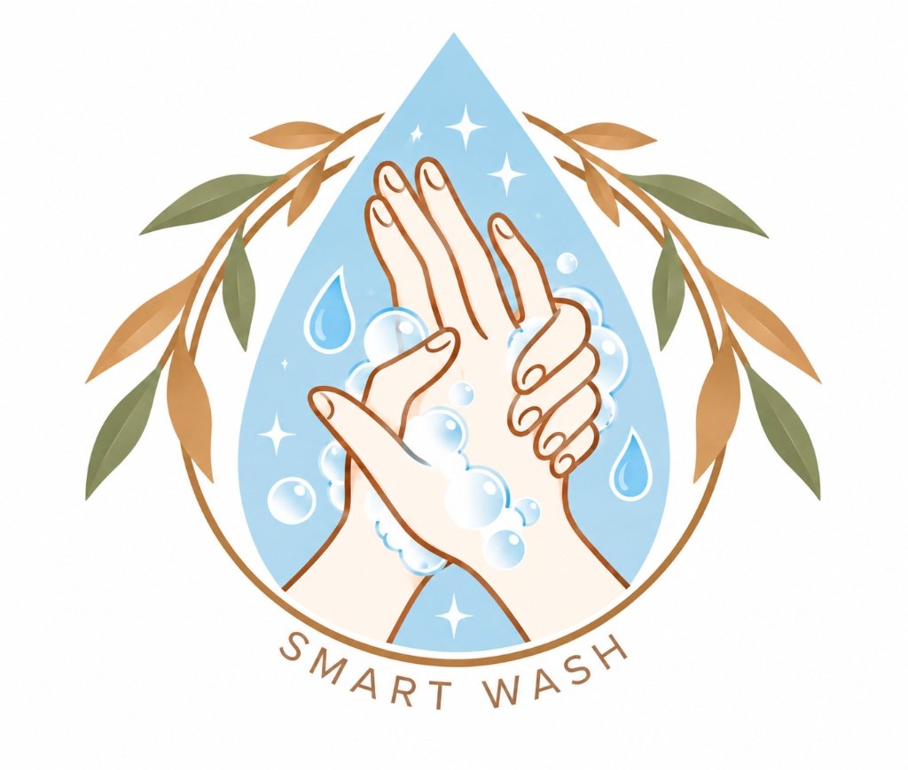

<p align="center">
  
</p>

# SMART WASH — Little hands, healthy habits

Autonomous AI Handwashing Compliance & Identification Platform. Little hands, healthy habits.

> 📖 **Operator & User Guide**: For complete step-by-step instructions, camera positioning, and WHO handwashing techniques, see [HOW_TO_USE.md](HOW_TO_USE.md).

## 📁 Project Architecture & Team Roles

- **🧠 Jobiya**: Hand landmark extraction & Keras/TF.js LSTM step recognition model (`ml/`)
- **🔐 Jesty**: Face ID recognition hook (`useFaceRecognition`), Firebase config, shared data contract (`shared/types.js`), student enrollment, and session management (`shared/services/`)
- **🖥️ Joel**: Kiosk App frontend shell (`apps/student-app`)
- **📊 Rahul**: Handwash scoring formula, voice/feedback system, and teacher dashboard (`apps/teacher-dashboard`)

---

## 🚀 Jesty's Module Integration Guide

### 1. Shared Data Contract (`shared/types.js`)
All team members must use the agreed `Session` shape:
```js
{
  studentId: string,
  studentName: string,
  timestamp: Timestamp | string,
  steps: [
    { stepNumber: number, completed: boolean, durationMs: number, avgConfidence: number }
  ],
  score: number   // 0 - 100
}
```

### 2. Using `useFaceRecognition()` in Student App (Joel)
```jsx
import { useFaceRecognition } from '../../shared/hooks/useFaceRecognition.js';

const { matchedStudent, confidence, isDetecting } = useFaceRecognition({
  videoRef,
  enabled: state === 'identifying'
});
```

### 3. Creating & Updating Sessions (Joel & Rahul)
```js
import { createSession, updateSession } from '../../shared/services/sessionService.js';

// When student identified:
const { id, session } = await createSession(student.studentId, student.name);

// When washing completes:
await updateSession(id, {
  score: finalScore,
  steps: completedSteps,
  status: 'completed'
});
```

---

## 🛠️ Dev & Testing Commands

```bash
# Install dependencies
npm install

# Start local interactive test workbench
npm run dev

# Run automated tests for Jesty's module
npm test
```

---

## 🌐 Application Routing Architecture

The application provides a unified entry experience with isolated mode environments:

- **Portal Mode Selection (`/`)**: The root route renders [`LandingModeSelect`](file:///c:/Users/jobiy/Downloads/smart-wash-main/smart-wash-main/src/components/LandingModeSelect.jsx), allowing users/operators to choose between the Student Kiosk or the Teacher Portal.
- **Student Kiosk (`/student`)**: This route serves [`StudentKioskApp`](file:///c:/Users/jobiy/Downloads/smart-wash-main/smart-wash-main/apps/student-app/src/StudentApp.jsx). It is responsive and optimized for mobile phones or touch-screen tablets mounted at the sink. It autonomously handles AI computer vision, Face ID recognition, and 6 WHO step guidance. Includes an easy `Exit Kiosk` navigation button.
- **Teacher Portal (`/teacher`)**: This route serves [`TeacherDashboardApp`](file:///c:/Users/jobiy/Downloads/smart-wash-main/smart-wash-main/apps/teacher-dashboard/src/TeacherDashboardApp.jsx). It features secure staff email/password authentication (Option A) to protect student biometric data, and provides compliance trend graphs, student roster management, biometric face enrollment, and leaderboards.

Both interfaces communicate with the same shared backend and data services to sync sessions and student profiles.
